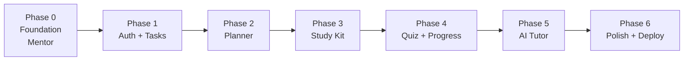
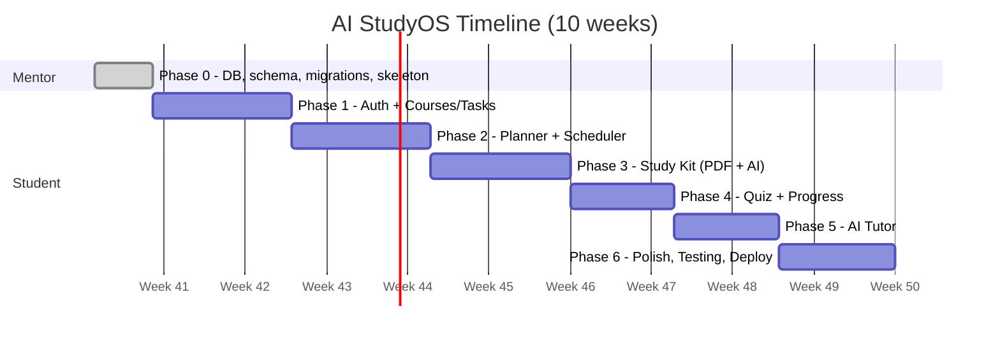
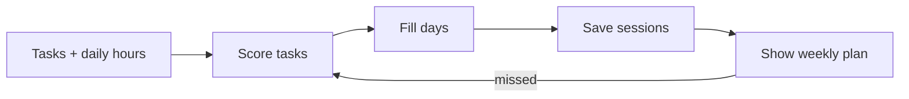
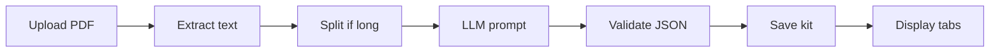

# AI StudyOS — Project Management Plan

**Duration:** 10 weeks | **Team:** 1 student developer + 1 mentor | **Stack:** Next.js, FastAPI, PostgreSQL **Companion document:** Simplified PRD (scope, features, API list)

---

## 1. Roles

| Role | Responsibilities |
| --- | --- |
| **Mentor** | Builds Phase 0 (database + skeleton), reviews code and PRs, unblocks the student, approves phase completion, helps with demo prep |
| **Student (Developer)** | Builds all features from Phase 1 onward, writes tests and docs, demos at each phase end |

**Working rhythm**

- 2 check-ins per week (30 min): one planning, one code review
- Weekly demo at the end of each phase
- Work in small feature branches; every merge is a pull request reviewed by the mentor
- Task board (GitHub Projects or Trello): *Backlog → In Progress → In Review → Done*

## 2. Phase Overview





*(Dates are placeholders: shift the start date to your actual kick-off.)*

## 3. Phase 0 — Foundation (Mentor) · \~Week 0

**Goal:** Give the student a working base so they only build features, never fight setup.

| # | Deliverable | Done when |
| --- | --- | --- |
| 0.1 | GitHub repo with `frontend/` and `backend/` folders, README, `.gitignore`, `.env.example` | Student can clone and run |
| 0.2 | PostgreSQL running (Docker Compose or local) | `docker compose up` starts the DB |
| 0.3 | **All tables created** via SQLAlchemy models | Models exist for every table below |
| 0.4 | Alembic configured + **initial migration** applied | `alembic upgrade head` creates every table |
| 0.5 | FastAPI skeleton: app factory, DB session dependency, config loader, health route `/health`, folder structure (routers, models, schemas, services) | `/docs` opens and `/health` returns OK |
| 0.6 | Next.js skeleton: Tailwind + shadcn/ui installed, layout, API client helper, empty pages for all screens | `npm run dev` shows the navigation |
| 0.7 | Optional seed script with a demo user and sample data | `python seed.py` runs |
| 0.8 | Handover doc: setup steps, folder map, schema diagram, how to add a migration | Student runs the project alone on day 1 |

**Tables created in Phase 0**

| Table | Main columns |
| --- | --- |
| users | id, email, password_hash, daily_hours, created_at |
| courses | id, user_id, name |
| tasks | id, course_id, title, type, due_date, difficulty, status |
| sessions | id, task_id, date, minutes, status |
| documents | id, course_id, filename, file_path, extracted_text |
| study_kits | id, document_id, summary, concepts (JSON), flashcards (JSON) |
| questions | id, kit_id, question, options (JSON), answer, topic |
| quiz_results | id, user_id, document_id, topic, score, taken_at |
| chat_messages | id, user_id, mode, role, content, created_at |

**Suggested backend structure**

```
backend/
  app/
    main.py
    core/        (config, security, db session)
    models/      (SQLAlchemy models, one file per table)
    schemas/     (Pydantic - student fills)
    routers/     (empty files per area - student fills)
    services/    (planner.py, ai.py, pdf.py - student fills)
  alembic/
  tests/
```

**Rule after Phase 0:** schema changes are allowed, but only as new Alembic migrations (never edit the database by hand, never edit old migrations). Tell the mentor before changing a table.

## 4. Student Phases

Each phase lists the goal, tasks, a demo, and an exit check the mentor signs off.

### Phase 1 — Auth, Courses and Tasks (Weeks 1–2)

**Goal:** A user can sign up, log in, and manage courses and tasks.

| Backend | Frontend |
| --- | --- |
| Register/login with hashed passwords and JWT | Login and register pages |
| Auth dependency that protects routes | Store token, redirect when logged out |
| CRUD for courses and tasks (only the user's own data) | Dashboard shell, courses list, task form and table |
| Set `daily_hours` | Settings field for daily study hours |

**Demo:** Register → add a course → add 3 tasks → refresh and data persists. **Exit check:** Unauthorized requests rejected; at least 5 backend tests pass.

### Phase 2 — Study Planner (Weeks 3–4)

**Goal:** Generate and manage a weekly schedule.

- Write the priority scoring function in `services/planner.py` (urgency + difficulty, exam bonus)
- `POST /plan/generate` fills days using `daily_hours`, saves rows in `sessions`
- `GET /plan` and `PATCH /sessions/{id}` (done/missed)
- Reschedule button re-runs the planner for unfinished work
- Weekly planner UI (table first, FullCalendar optional)

**Demo:** Add an exam in 3 days and a quiz tomorrow → schedule prioritizes correctly → mark one missed → reschedule. **Exit check:** Planner unit tests cover urgent task, no free hours, and missed session cases.



### Phase 3 — Lecture-to-Study Kit (Weeks 5–6)

**Goal:** Upload a PDF and receive a study kit.

- PDF upload endpoint (10 MB limit, PDF only), save file, extract text with PyMuPDF
- `services/ai.py`: one function that calls the LLM and returns validated JSON
- Prompt for summary + concepts + flashcards; validate with Pydantic; retry once on bad JSON
- Long PDFs: split into sections, summarize, merge
- Study kit page with tabs (Summary, Concepts, Flashcards)
- Show a loading state while generating (use `BackgroundTasks` and a status field if needed)

**Demo:** Upload a real lecture PDF → kit appears in under 60 seconds. **Exit check:** Bad or empty PDFs show a friendly error; API key stays in `.env`.



### Phase 4 — Quiz and Progress (Weeks 7–8, first half)

**Goal:** Practice with MCQs and see weak topics.

- Extend the kit generation to produce MCQs with a `topic` label
- Quiz page: answer, submit, score per topic saved in `quiz_results`
- `GET /progress` returns average score per topic and completed sessions
- Progress page with a simple bar chart (Recharts)
- **Loop feature:** topics under 60% create a revision task in the planner

**Demo:** Take a quiz, fail a topic, see a revision task on the planner. **Exit check:** Scores calculate correctly; the loop works end to end.

### Phase 5 — AI Tutor (Week 8–9)

**Goal:** Chat with four explanation modes.

- `POST /tutor/chat` with `mode` and optional `document_id`
- Mode prompt templates stored in one config file (Beginner, Exam, Example, Quick Revision)
- When a document is selected, include its extracted text (trimmed) as context
- Save messages in `chat_messages`
- Chat UI with mode dropdown and message history

**Demo:** Ask "Explain eigenvectors" in all 4 modes; answers differ clearly. **Exit check:** Long documents are trimmed safely; errors from the LLM are handled.

### Phase 6 — Polish, Testing, Deployment (Weeks 9–10)

**Goal:** A demo-ready, deployed project.

- Fix bugs, loading and empty states, mobile responsiveness
- Backend tests for auth, planner, kit generation (mock the LLM)
- Deploy: frontend on Vercel, backend + Postgres on Render or Railway; run migrations in production
- README, API docs screenshot, architecture diagram, demo video (3–5 min)
- Final report/presentation material
- **Optional (P1):** Visual mode, email reminders, export kit as PDF

**Exit check:** Live link works for a fresh user from sign-up to quiz.

## 5. Milestones

| Milestone | End of | Success signal |
| --- | --- | --- |
| M0 – Foundation ready | Phase 0 | Student runs app and DB locally |
| M1 – Core app | Phase 1 | Login + CRUD works |
| M2 – Planner live | Phase 2 | Schedule generated and rescheduled |
| M3 – AI kit works | Phase 3 | PDF to study kit |
| M4 – Learning loop | Phase 4 | Quiz scores drive revision tasks |
| M5 – Tutor works | Phase 5 | 4 modes functional |
| M6 – Launch | Phase 6 | Deployed and demoed |

## 6. Mentor Review Checklist (per phase)

- Code runs from a fresh clone using the README
- Branches/PRs are small and clearly named
- New tables or columns come with an Alembic migration
- No secrets committed
- Basic tests exist for the new logic
- Student can explain how the feature works in their own words

## 7. Risks and Responses

| Risk | Response |
| --- | --- |
| Student gets stuck on setup | Phase 0 removes most setup work; handover doc covers common errors |
| Falling behind schedule | Cut P1 features first; Phase 5 and 6 buffers absorb slip |
| LLM output unreliable | Strict JSON prompts, validation, one retry, store results |
| API cost or rate limits | Free tier model, cache kits in DB, limit file size |
| Schema needs change mid-project | Allowed via new migration after notifying the mentor |
| Scope creep | New ideas go to a "Future" list, not the current phase |

## 8. Definition of Done (any task)

1. Works locally and passes its tests
2. Reviewed and merged via pull request
3. Migration included if the database changed
4. Documented briefly in the README or code comments
5. Demoed to the mentor