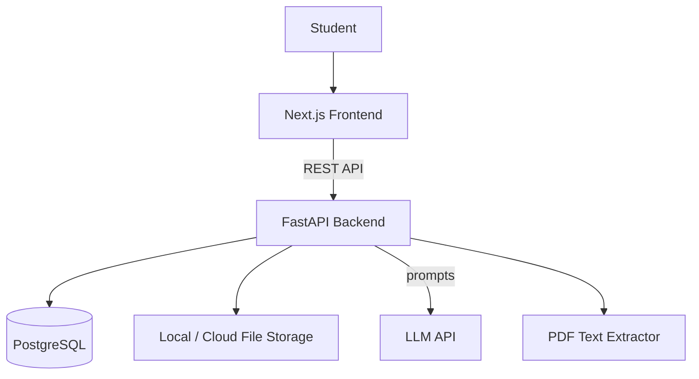
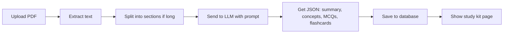
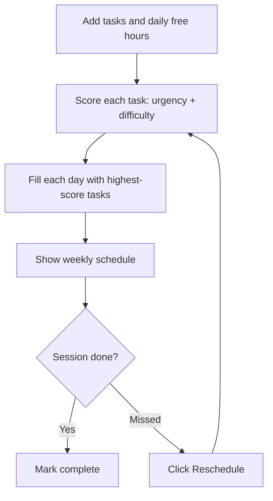
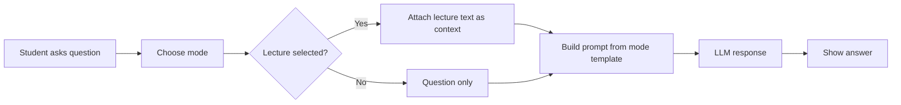
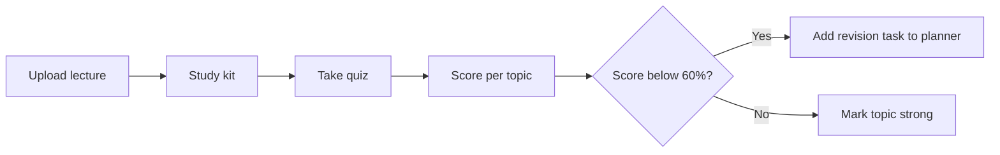
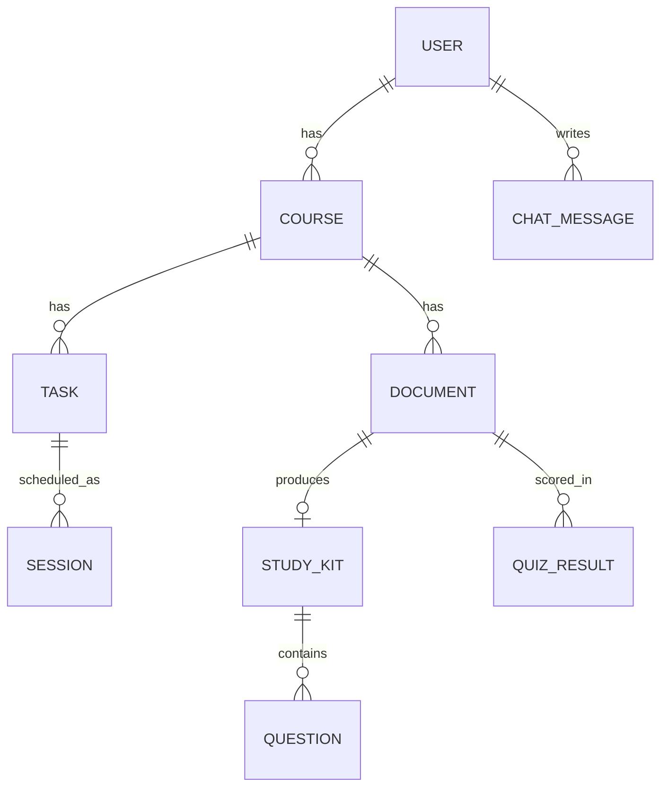

# AI StudyOS — Simplified PRD (University Project Edition)

**Scope:** 8–10 weeks | **Team:** 1–3 students | **Stack:** Next.js + FastAPI + PostgreSQL

---

## 1. What We're Building

AI StudyOS is a web app that helps a student **plan their study time**, **turn lectures into study material**, and **get explanations in the style they prefer**.

| Module | What it does (MVP) |
| --- | --- |
| **Study Planner** | Add tasks/exams with deadlines and daily free hours; get a simple schedule |
| **Study Kit** | Upload a PDF; get a summary, key concepts, MCQs and flashcards |
| **AI Tutor** | Ask a question and pick a mode (Beginner, Exam, Example, Quick Revision) |
| **Progress** | See what is done and which quiz topics are weak |

**Core demo story:** Upload a lecture → get a study kit → take the quiz → weak topics appear on the planner.

## 2. Goals and Scope

**In scope (MVP)**

- Email/password login
- Task and exam tracking with a rule-based schedule
- PDF upload (text-based PDFs) and AI-generated study kit
- Tutor chat with 4 explanation modes, optionally using an uploaded lecture as context
- Basic progress dashboard

**Out of scope (do later if time allows)**

- OCR for scanned PDFs, Google Calendar sync, push notifications
- Mobile app, payments, group study
- Vector search / advanced RAG, spaced repetition algorithm

## 3. Features

### Must have (P0)

| ID | Feature |
| --- | --- |
| F1 | Sign up / log in |
| F2 | Add, edit, delete courses and tasks (assignment, quiz, exam) with due date and difficulty |
| F3 | Enter daily available study hours |
| F4 | Generate a weekly schedule, sorted by deadline and difficulty |
| F5 | Mark sessions done or missed; **Reschedule** button re-plans remaining work |
| F6 | Upload PDF and generate summary, key concepts, 10 MCQs, 10 flashcards |
| F7 | Tutor chat with mode selector (Beginner / Exam / Example / Quick Revision) |
| F8 | Take a generated quiz and save the score per topic |

### Nice to have (P1)

| ID | Feature |
| --- | --- |
| F9 | Visual mode (tutor returns a Mermaid diagram) |
| F10 | "Weak topics" list that auto-adds revision sessions to the planner |
| F11 | Email reminders for upcoming deadlines |
| F12 | Export study kit as PDF |

## 4. Architecture

Kept simple: one frontend, one backend, one database. No queues or microservices.

## 5. Tech Stack

| Layer | Technology | Why it's student-friendly |
| --- | --- | --- |
| Frontend | **Next.js + TypeScript** | Popular, great docs |
| Styling/UI | Tailwind CSS + shadcn/ui | Ready-made components |
| Data fetching | Fetch / TanStack Query | Simple API calls |
| Calendar view | FullCalendar (or a simple weekly table) | Saves time |
| Backend | **FastAPI (Python)** | Fast to build, auto API docs at `/docs` |
| Validation | Pydantic | Built into FastAPI |
| Database | **PostgreSQL** | As required |
| ORM | SQLAlchemy + Alembic | Standard Python setup |
| Auth | JWT (python-jose + passlib) | Simple email/password |
| PDF parsing | PyMuPDF | One library, text-based PDFs |
| AI | One LLM API (OpenAI, Anthropic or Gemini free tier) | Ask for JSON output |
| Background tasks | FastAPI `BackgroundTasks` | No Redis/Celery needed |
| Scheduler logic | Plain Python function (priority score) | No ML needed |
| Deployment | Vercel (frontend), Render/Railway (backend + Postgres) | Free tiers |
| Dev tools | Git/GitHub, Docker Compose (optional), Postman |  |

## 6. Key Flows

### 6.1 Lecture to Study Kit

### 6.2 Study plan and rescheduling

**Simple priority formula:** `score = (difficulty × 2) + (10 − days_until_due)` — higher score gets scheduled first. Exams get a +5 bonus.

### 6.3 Tutor chat

**Mode templates (examples):**

- *Beginner:* "Explain like I'm new to this, using simple words."
- *Exam:* "Give a concise answer in 4–5 lines suitable for an exam."
- *Example:* "Explain mainly through one practical example."
- *Quick Revision:* "Give 5 bullet points."

### 6.4 The connected loop (the "OS" idea)

## 7. Database (Simple Version)

| Table | Main columns |
| --- | --- |
| users | id, email, password_hash, daily_hours |
| courses | id, user_id, name |
| tasks | id, course_id, title, type, due_date, difficulty, status |
| sessions | id, task_id, date, minutes, status |
| documents | id, course_id, filename, extracted_text |
| study_kits | id, document_id, summary, concepts (JSON), flashcards (JSON) |
| questions | id, kit_id, question, options (JSON), answer, topic |
| quiz_results | id, user_id, document_id, topic, score |
| chat_messages | id, user_id, mode, role, content |

*Tip: storing concepts and flashcards as JSON columns keeps the schema small.*

## 8. API Endpoints

| Area | Endpoints |
| --- | --- |
| Auth | `POST /auth/register`, `POST /auth/login` |
| Tasks | `GET/POST /tasks`, `PUT/DELETE /tasks/{id}` |
| Planner | `POST /plan/generate`, `GET /plan`, `PATCH /sessions/{id}` |
| Documents | `POST /documents`, `GET /documents/{id}` |
| Study kit | `POST /documents/{id}/generate`, `GET /kits/{id}` |
| Quiz | `POST /quiz/submit`, `GET /progress` |
| Tutor | `POST /tutor/chat` |

## 9. Screens

1. Login / Register
2. Dashboard (today's plan, upcoming deadlines, progress summary)
3. Planner (weekly view + add task)
4. Documents (upload list)
5. Study Kit (tabs: Summary, Concepts, MCQs, Flashcards)
6. Tutor chat (mode dropdown)
7. Progress (scores per topic)

## 10. Non-Functional Basics

- Study kit generation within about 60 seconds (show a loading spinner)
- PDF limit: 10 MB, up to \~40 pages (truncate or section longer files)
- Passwords hashed; each user sees only their own data
- Works on desktop and mobile browsers (responsive Tailwind layout)
- Keep API keys in `.env`, never in Git

## 11. Timeline (8–10 weeks)

| Week | Goal |
| --- | --- |
| 1 | Setup repo, Next.js + FastAPI + Postgres, auth |
| 2–3 | Tasks, availability, scheduler, planner UI |
| 4–5 | PDF upload, text extraction, study kit generation |
| 6 | Quiz and flashcard pages, save scores |
| 7 | Tutor chat with modes |
| 8 | Progress page + connect weak topics to planner |
| 9 | Testing, bug fixes, UI polish |
| 10 | Deployment, report, demo video |

**If you have 2–3 members:** one on frontend, one on backend/database, one on AI prompts + testing + documentation.

## 12. Success Criteria

- A new user can sign up, add tasks and get a schedule in under 3 minutes
- A text-based PDF produces a usable study kit
- Tutor answers visibly differ across the 4 modes
- Quiz scores appear in progress and weak topics create revision tasks
- App is deployed and demoable with a live link

## 13. Risks and Easy Fixes

| Risk | Fix |
| --- | --- |
| LLM returns bad JSON | Ask for strict JSON, retry once, validate with Pydantic |
| Long PDFs exceed limits | Split by sections, summarize each, then merge |
| API cost/limits | Use a free tier or cheaper model; cache results in the DB |
| Time runs short | Cut P1 features first; the core demo story still works |
| Scanned PDFs fail | State "text-based PDFs only" in the UI |

## 14. Future Improvements

OCR for scanned notes, vector search (pgvector) for large documents, spaced-repetition flashcards, calendar sync, email/push reminders, and a mobile app.