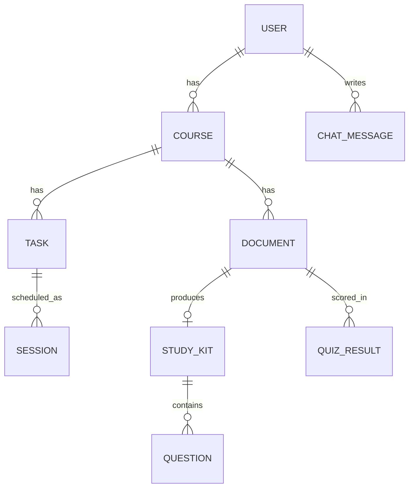

# Phase 0 Handover — Mentor → Student

Date: 2026-10-05. Goal: you run the full stack alone on day 1, then build Phase 1.

## 1. Setup (do this first, ~15 min)

1. Clone repo, then start Postgres: `docker compose up -d` (or create local db `aistudyos`).
2. Backend:
   ```
   cd backend
   py -m venv .venv; .\.venv\Scripts\Activate.ps1
   py -m pip install -r requirements.txt
   copy ..\.env.example .env
   # set JWT_SECRET_KEY: py -c "import secrets; print(secrets.token_urlsafe(32))"
   alembic upgrade head
   py -m pytest -q        # expect 3 passed
   py -m uvicorn app.main:app --reload --port 8000
   ```
   Open http://localhost:8000/docs and http://localhost:8000/health.
3. Frontend (second terminal):
   ```
   cd frontend
   npm install
   copy .env.example .env.local
   npm run dev
   ```
   Open http://localhost:3000 — nav lists all 7 screens (placeholders with TODOs).
4. Optional seed: `py seed.py` (in backend/) → demo user + 3 tasks.

## 2. Folder map (where to put Phase 1 code)

| You build | File |
|---|---|
| Register/login, JWT dependency | `backend/app/routers/auth.py`, `app/core/security.py`, `app/schemas/auth.py` (new) |
| Courses/tasks CRUD | `backend/app/routers/tasks.py`, `app/schemas/task.py` (new) |
| `daily_hours` setting | `users.daily_hours` column already exists |
| Login/register pages, token storage | `frontend/app/login/page.tsx`, `app/register/page.tsx`, `lib/api.ts` |
| Dashboard shell, task table | `frontend/app/page.tsx` |

Services/routers already have stub files with TODOs — replace the `_stub` route, don't delete the file.

## 3. Schema diagram



| Table | Key columns |
|---|---|
| users | id PK, email UNIQUE, password_hash, daily_hours FLOAT default 2.0, created_at |
| courses | id PK, user_id FK→users CASCADE, name, created_at |
| tasks | id PK, course_id FK CASCADE, title, type (assignment/quiz/exam), due_date DATE, difficulty 1-5, status (pending/done/missed) |
| sessions | id PK, task_id FK CASCADE, date DATE, minutes default 60, status (scheduled/done/missed) |
| documents | id PK, course_id FK SET NULL nullable, filename, file_path, extracted_text TEXT nullable |
| study_kits | id PK, document_id FK UNIQUE CASCADE, summary TEXT, concepts JSON, flashcards JSON |
| questions | id PK, kit_id FK CASCADE, question TEXT, options JSON, answer, topic nullable indexed |
| quiz_results | id PK, user_id FK CASCADE, document_id FK SET NULL nullable, topic nullable, score FLOAT, taken_at |
| chat_messages | id PK, user_id FK CASCADE, mode (beginner/exam/example/quick_revision), role (user/assistant), content TEXT |

JSON columns use Postgres JSONB in production, plain JSON in SQLite tests.

## 4. How to add a migration (do this every time the schema changes)

```powershell
# 1. Edit the SQLAlchemy model in backend/app/models/
# 2. Generate:
alembic revision --autogenerate -m "add xyz column"
# 3. Inspect backend/alembic/versions/<new>.py, then apply:
alembic upgrade head
# 4. Commit BOTH the model change and the migration file in one PR.
```

Rules: never edit `0001_phase0_initial.py`, never `downgrade` production, tell the mentor before changing a table.

## 5. How auth will work (preview, Phase 1)

- `POST /auth/register`: hash with bcrypt → store `password_hash`.
- `POST /auth/login`: verify → return JWT (HS256, `JWT_SECRET_KEY`, expires `JWT_EXPIRE_MINUTES`).
- Protected routes: `Authorization: Bearer <token>` → `get_current_user` → filter every query by `user_id`.
- Frontend: `lib/api.ts` already attaches the token from `localStorage`.

## 6. How the planner/AI slots in (preview)

- `services/planner.py::priority_score` docstring has the exact PRD formula — implement in Phase 2.
- `services/pdf.py` + `services/ai.py` are called by `routers/documents.py` in Phase 3 (10 MB limit, `MAX_UPLOAD_MB` in `.env`).
- Tutor modes live in one config dict in Phase 5; chat history goes to `chat_messages`.

## 7. Common errors

| Symptom | Fix |
|---|---|
| `connection refused :5432` | `docker compose up -d`; check `DATABASE_URL` host (localhost vs `db`) |
| `alembic: command not found` | venv not activated or `pip install -r requirements.txt` missed |
| `JWT_SECRET_KEY` default | generate one, restart uvicorn |
| `npm run dev` port clash | `npm run dev -- -p 3001`, update CORS in backend `.env` |
| CORS error in browser | `BACKEND_CORS_ORIGINS` must include the frontend URL |
| Seed duplicates | seed.py is idempotent — safe to re-run; duplicates mean you changed the email constant |

## 8. Done checklist (M0 sign-off)

- [ ] `/health` → ok, `/health/db` → connected, `/docs` loads.
- [ ] 9 tables visible in DB (`\dt` in psql).
- [ ] Frontend nav renders, `NEXT_PUBLIC_API_URL` points at backend.
- [ ] `py seed.py` runs twice cleanly; no secrets committed (`git status` shows no `.env`).
